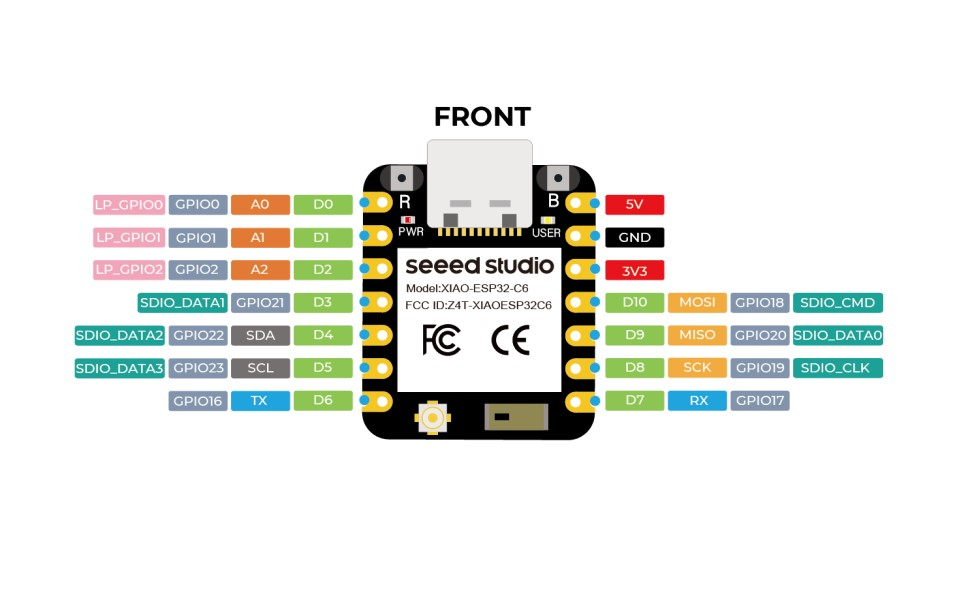

# BoatControl

Катер: джойстик JH-D400X-R4 → XIAO ESP32-C6 → ESC (мотор) + серва (руль), кнопка круиза + зуммер.

## Схема

```
              XIAO ESP32-C6
   Стик X (руль) ──D0/GPIO0──┐            ┌──D4/GPIO22──→ сигнал ESC ──→ мотор
   Стик Y (газ)  ──D1/GPIO1──┤  ADC1      │
                             ├─ 50 Гц ────┼──D5/GPIO23──→ сигнал сервы ──→ руль
   Кнопка круиза ──D3/GPIO21─┤  LEDC      │
                             │            └──D8/GPIO19──→ зуммер (+ на пин, − на GND,
   LED готов  ←───D6/GPIO16──┤                              HIGH = писк)
   LED круиз  ←───D7/GPIO17──┘

   Джойстик JH-D400X-R4: 10 кОм, питание 3V3, ось Z и кнопка стика не используются.
   BEC/UBEC 5–6V ──→ серва и 5V платы; GND силовой и логики общий.
   Рубильник и предохранитель — в силовой цепи.
```

## Документация

- [docs/SPEC.md](docs/SPEC.md) — логика, карты, состояния, fail-safe
- [docs/HARDWARE.md](docs/HARDWARE.md) — пины, схема входа, питание, BOM
- [docs/PLATFORM.md](docs/PLATFORM.md) — PlatformIO + pioarduino 55.03.312, команды

## Плата



## Прошивка

### С платформы (PIO)
```bash
git checkout v1.0
pio run -t upload
```

### `esptool` v5.6.0 standalone (без Python)
1. Скачать [`esptool-v5.6.0-windows-amd64.zip`](https://github.com/espressif/esptool/releases/download/v5.6.0/esptool-v5.6.0-windows-amd64.zip), распаковать.
2. Скачать [`boatcontrol-v1.0-factory.bin`](https://github.com/AlksSAV/BoatControl/releases/download/v1.0/boatcontrol-v1.0-factory.bin) из релиза.
3. Положить оба файла в одну папку, открыть `cmd`:
```cmd
esptool --chip esp32c6 -p COM7 -b 1500000 write_flash 0x0 boatcontrol-v1.0-factory.bin
```
`COM7` — порт платы (Диспетчер устройств). `factory.bin` = bootloader + partitions + app, флешится от `0x0`. Если на плате уже стоит прошивка — можно использовать `boatcontrol-v1.0-app.bin` (offset `0x10000`).

### Espressif Web Flasher (без установки)
Открыть в Chrome или Edge (Web Serial, не Safari): https://espressif.github.io/esptool-js/
1. **Connect** → выбрать порт платы.
2. В секции **Program**: **Flash Address** = `0x0`, **File** = `boatcontrol-v1.0-factory.bin`.
3. **Program**.

### Flash Download Tool (GUI)
[Flash Download Tool v3.10.0](https://www.espressif.com/en/support/download/other-tools) — Windows, графический интерфейс.
Адрес: `0x0`, файл `boatcontrol-v1.0-factory.bin`. ESP32-C6 официально не заявлен (версия 2023 г.).

### Нюансы XIAO ESP32-C6
- Прошивается через USB (GPIO12/13), внешний UART не нужен.
- Если порт не появляется — удерживать **BOOT** при подключении кабеля.
- Рубильник в силовой цепи обязателен (SPEC п.7).
